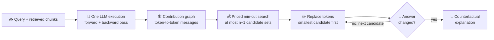
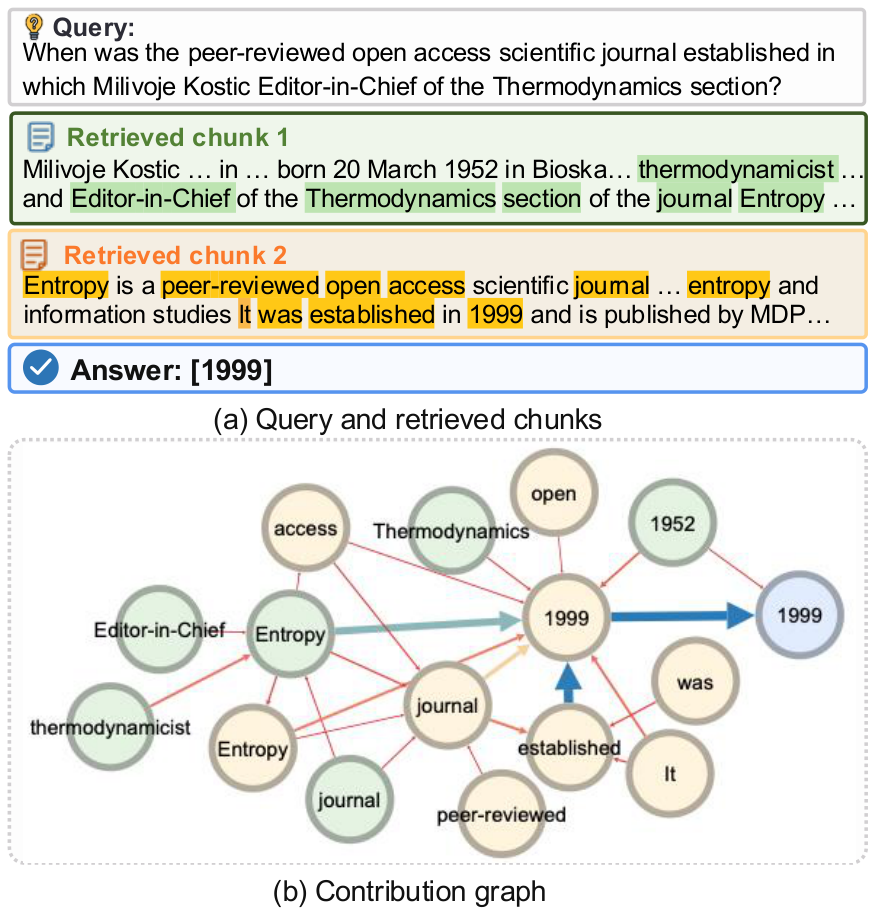
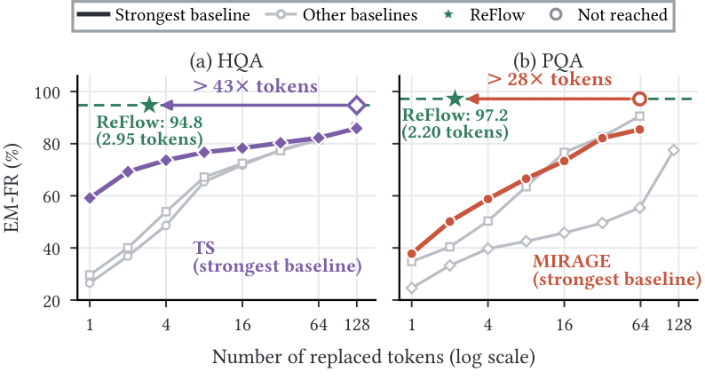

<div align="center">

# 🌊 ReFlow

### Efficient Counterfactual Explanations for Retrieval-Augmented Generation

**Which retrieved tokens does a RAG answer actually hinge on?**
ReFlow finds a handful of them, then proves it by changing them and rerunning the model.

[](docs/REPRODUCTION.md#environment)
[](requirements-gpu.txt)
[](requirements-gpu.txt)
[](tests)
[](https://github.com/JayLZhou/TechnicalReport/blob/main/VLDB2027-RAGExplain.pdf)

[✨ Highlights](#-highlights) ·
[⚙️ How it works](#️-how-it-works) ·
[📊 Results](#-results) ·
[🚀 Quick start](#-quick-start) ·
[🧪 Reproduce](#-reproduce-the-paper) ·
[🗂️ Layout](#️-repository-layout)

</div>

---

## ✨ Highlights

- 🎯 **A new problem.** Token-level Counterfactual Explanation (TCE): the smallest set of retrieved tokens whose joint replacement changes the answer.
- 🕸️ **One execution, one graph.** A single LLM run yields a contribution graph of how tokens jointly reach the answer.
- ✂️ **From $2^n-1$ to $n+1$.** A contract-priced min-cut search needs at most $n+1$ candidate sets, each from one max-flow computation.
- ✅ **Verified, not just scored.** Every returned set is confirmed by rerunning the same LLM on the edited context.
- 🏆 **Best on all 8 datasets**, against 9 baselines, with only **3.28 edited tokens** per query on average.
- 🛠️ **Useful downstream**: token-efficient RAG attacks, evidence-guarded defenses, and answer provenance.

## 🤔 The problem

Attribution methods score tokens one at a time, but an answer often survives unless several facts change together. TCE asks for the set directly:

$$
T^* \in \arg\min_{T \subseteq \mathrm{Token}(C)} |T|
\quad \text{s.t.} \quad
\mathcal{R}_q\big(C[T \leftarrow \Psi(T)]\big) \not\equiv \mathcal{R}_q(C)
$$

Here $\Psi$ swaps a token for a same-type alternative that makes its sentence state a different fact. It is neither a deletion nor a paraphrase.

## ⚙️ How it works



| Stage | What happens | Code |
|---|---|---|
| 🕸️ **Contribution graph** | Split attention into token-to-token messages, weigh each by its effect on the answer logits, and aggregate across layers | [`message_flow.py`](causalityrag/message_flow.py), [`contribution_graph.py`](causalityrag/contribution_graph.py) |
| 💧 **Residual flow** | Max flow left after removing a token set estimates how much support for the answer remains | [`max_flow.py`](causalityrag/max_flow.py) |
| 💰 **Contract-priced search** | A price per token trades set size against residual flow; divide and conquer over prices finds every candidate | [`flow_contract.py`](causalityrag/flow_contract.py), [`run_reflow.py`](exp/run_reflow.py) |
| 🔁 **Verification** | Rerun the LLM on each candidate in increasing size and return the first that flips the answer | [`evaluate_reflow.py`](scripts/evaluate_reflow.py) |

<div align="center">

<br/><em>A real contribution graph for a multi-hop HotpotQA query.</em>
</div>

## 📊 Results

Flip rates (%) with Qwen2.5-7B under the same per-query token budget for every method. **Ans** counts answers that change; **EM** counts correct answers that become wrong under exact match.

| 📚 Dataset | ReFlow Ans | Best baseline | Gain | ReFlow EM | Best baseline | Gain |
|---|:---:|:---:|:---:|:---:|:---:|:---:|
| HotpotQA | **95.1** | TS 76.3 | 🟢 +18.8 | **94.8** | TS 70.9 | 🟢 +23.9 |
| TimeQA | **93.4** | ARC-JSD 76.2 | 🟢 +17.2 | **99.0** | TS 79.9 | 🟢 +19.1 |
| FinQA | **84.9** | TS 60.7 | 🟢 +24.2 | **82.7** | ARC-JSD 63.0 | 🟢 +19.7 |
| MuSiQue | **95.3** | ARC-JSD 71.0 | 🟢 +24.3 | **99.3** | ARC-JSD 79.3 | 🟢 +20.0 |
| QuaRTz | **26.1** | MiCE-RAG 17.5 | 🟢 +8.6 | **23.4** | RAGE 16.0 | 🟢 +7.4 |
| TriviaQA | **76.8** | MIRAGE 31.0 | 🟢 +45.8 | **70.2** | MIRAGE 23.0 | 🟢 +47.2 |
| 2WikiMultiHopQA | **90.1** | MIRAGE 63.8 | 🟢 +26.3 | **94.8** | MIRAGE 67.1 | 🟢 +27.7 |
| PopQA | **98.1** | MIRAGE 60.1 | 🟢 +38.0 | **97.2** | MIRAGE 49.9 | 🟢 +47.3 |

📈 Across all 46 metric columns in the paper, ReFlow leads the strongest baseline by an average of **25.4 points** on flip rates and **21.0 points** on counterfactual flip rates, which subtract the flips caused by rewording alone.

<div align="center">

<br/><em>Top-ranked tokens that baselines must replace to catch up with ReFlow.</em>
</div>

<details>
<summary>⚡ <b>Efficiency</b></summary>

| Measure | Value |
|---|---|
| Candidate sets per query | 8.2–27.3, a 4.5–48.5× reduction from the $n+1$ bound |
| LLM verification runs per query | 1.4–6.2 |
| End-to-end time on HotpotQA | 4.7 s per query (graph 4.15 s, search 0.14 s, verification 0.39 s) |
| Peak GPU memory on HotpotQA | 30.3 GB |

</details>

<details>
<summary>🛠️ <b>Downstream applications</b></summary>

| Application | Result on 100 HotpotQA queries unless noted |
|---|---|
| ⚔️ **RAG attack** | 83.0% success with 3.19 modified tokens; PoisonedRAG reaches 81.0% with 174.9, TPARAG 61.0% with 538.2 |
| 🛡️ **RAG defense** | ReFlow-Guard keeps 75.0% accuracy with 71.0 context tokens; Keyword-Guard 44.0% and Decoding-Guard 22.0% with 1,306.3 |
| 🔎 **Provenance** (MuSiQue) | 24.21 F1 from 48.8 tokens, nearly matching 24.83 F1 from all 550.0 retrieved tokens |

</details>

## 🚀 Quick start

```bash
git clone https://github.com/JayLZhou/CausalityRAG.git && cd CausalityRAG

python3 -m venv .venv && source .venv/bin/activate
pip install -r requirements-gpu.txt -r requirements-dev.txt
python -m nltk.downloader wordnet omw-1.4
python -m spacy download en_core_web_lg

python -m pytest -q tests   # 🧪 no GPU needed
```

> [!IMPORTANT]
> Graph construction needs a CUDA GPU; the paper's runs used A100-class cards. The reader is served through vLLM, which is installed separately because its wheel depends on your CUDA and PyTorch versions.

Once the inputs of the [main experiment](docs/REPRODUCTION.md#complete-main-experiment) exist (retrieval results, token units, the frozen replacement pool, and contribution graphs), the ReFlow step is:

```bash
python exp/run_reflow.py \
  --input "$RETRIEVAL" --graphs "$GRAPH" --units-cache "$TOKEN_UNITS" \
  --shared-pool "$FACTUAL_POOL" --expected-pool-sha256 "$FACTUAL_POOL_SHA" \
  --out "$FRONTIER" --summary-out "$FRONTIER_SUMMARY" \
  --start 0 --n 1000 --k 5
```

## 🧪 Reproduce the paper

📘 **[`docs/REPRODUCTION.md`](docs/REPRODUCTION.md) is the full guide**: frozen protocol, every command, metric definitions, and the audits that must pass.

| Experiment | Where to look |
|---|---|
| 🥇 Main table on 8 datasets | [Complete main experiment](docs/REPRODUCTION.md#complete-main-experiment) |
| 💸 Fixed budget and budget-to-match | [Section A](docs/REPRODUCTION.md#a-fixed-budget-and-budget-to-match) |
| 🎲 Token Shapley baseline | [Section B](docs/REPRODUCTION.md#b-token-shapley-baseline) |
| 🔬 Search protocol and residual-flow fidelity | [Section C](docs/REPRODUCTION.md#c-search-protocol-and-algorithm-analyses) |
| 🎚️ Retrieval depth, receiver beam, backbone | Sections [D](docs/REPRODUCTION.md#d-retrieval-depth-sensitivity), [E](docs/REPRODUCTION.md#e-receiver-beam-sensitivity), [F](docs/REPRODUCTION.md#f-reader-model-sensitivity) |
| ⚔️ Poisoning, defense, provenance | Sections [G](docs/REPRODUCTION.md#g-rag-poisoning-and-defense), [H](docs/REPRODUCTION.md#h-evidenceprovenance-sufficiency) |
| 🧩 Flow ablation, runtime, memory, new baselines, transfer, and more | [`revision/`](revision) |

## 🗂️ Repository layout

```text
📦 causalityrag/        graph, flow, token, pool, reader, and metric primitives
🏃 exp/                 ReFlow and the attribution and Shapley rankers
🔧 scripts/             preparation, evaluation, aggregation, audit, and render tools
   └─ launchers/        original server launch scripts, kept as a record
🧪 revision/            experiments added during the paper revision
⚙️  configs/             frozen protocol checklists
✅ tests/               unit, integration, metric, and protocol tests
📈 artifacts/           aggregate results and audit records
🖼️  figures/             rendered outputs and their data
📘 docs/                reproduction guide and runbook
```

## ⚠️ Scope

- 🔓 **Open-weight generators.** ReFlow reads attention and gradients, so it cannot build its graph for API-only models.
- 🧭 **Surrogate, then verify.** Residual flow orders the candidates. The returned set really does change the answer, but it is not guaranteed to be the globally smallest one.
- 🗄️ **No datasets or weights here.** The repository stores code and aggregate results; you need the source datasets and models to rerun from scratch.
- 🖥️ **Launchers are a record.** Files in `scripts/launchers/` and `revision/` keep their original paths and GPU assignments. The Python entry points in `exp/` and `scripts/` are the portable interface.

---

<div align="center">

Found something off? 🐛 [Open an issue](https://github.com/JayLZhou/CausalityRAG/issues). If ReFlow helps your work, a ⭐ is always welcome!

</div>
